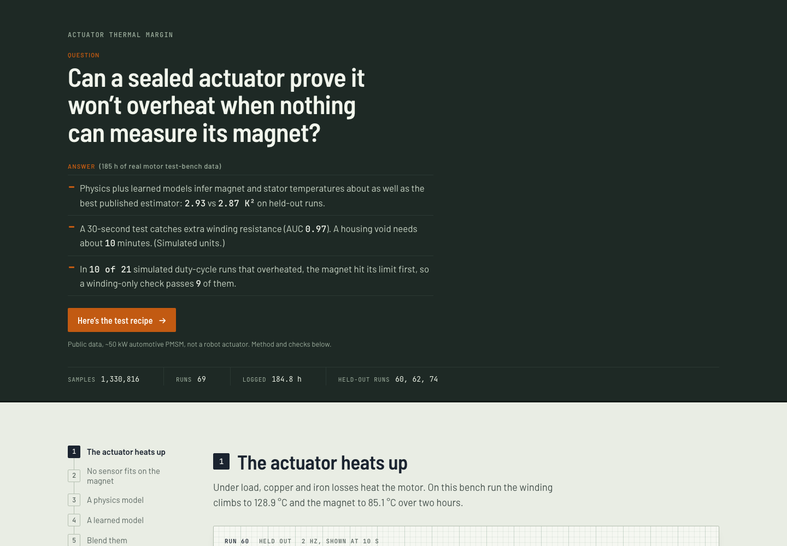
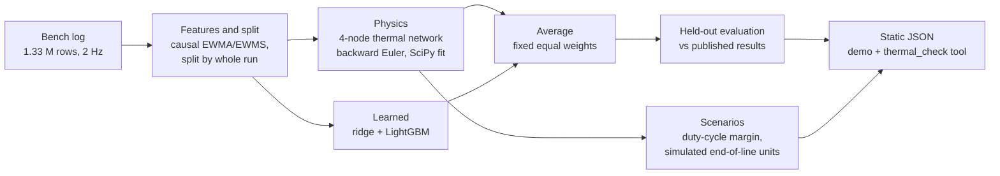
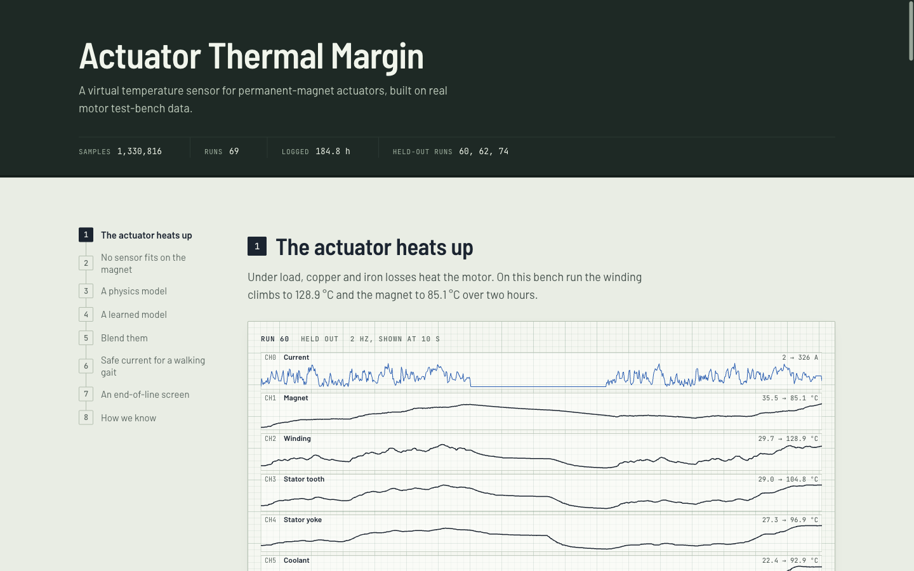

# Actuator Thermal Margin

**A virtual temperature sensor for permanent-magnet motors, built and validated on 185 hours of real test-bench data.**

[](tests/)
[](LICENSE)
[](https://creativecommons.org/licenses/by-sa/4.0/)
[](requirements.txt)
[](web/)

<p align="center">
  <a href="https://ibiraheel.com/demos/actuator-thermal-margin/">
    
  </a>
</p>

<p align="center"><b><a href="https://ibiraheel.com/demos/actuator-thermal-margin/">Live demo</a></b> · <a href="METHOD.md">Method</a> · <a href="SOLUTION.md">Test recipe</a></p>

---

## The question

How do you prove a sealed motor actuator will hold its duty cycle without overheating when nothing can measure the magnet, and how short can the end-of-line test be before bad units slip through?

## The answer

- **Virtual sensor.** A physics thermal network averaged with two learned models infers magnet and stator temperatures with 2.93 K² mean squared error on held-out motor runs. The best published estimator on the same split scores 2.87 K².
- **Test length.** On simulated units, a 30-second test catches extra winding resistance (AUC 0.97). A void in the stator-to-housing interface needs about 10 minutes (AUC 0.50 at 30 s, 0.95 at 600 s).
- **Derating.** In 10 of the 21 simulated duty-cycle runs that overheated, the magnet crossed its limit first. A winding-only check would have passed 9 of them.

## The solution

A one-page thermal test recipe and a small command-line tool that applies it:

1. Fit a 4-node thermal network to a golden unit and gate it with a hand calculation.
2. Pick the end-of-line test length by defect class: 30 s for resistance, 1–2 min for slot impregnation, about 10 min (or a hot soak) for housing voids.
3. Fail units whose measured-minus-model winding residual sits above the 99th percentile of good units.
4. Derate on the magnet, with a safe-peak-current table per duty cycle and coolant temperature.

`python -m pipeline.thermal_check screen` applies steps 2–3 and `margin` applies step 4, on data in the bench-log format. The full playbook, with the results behind each rule, is in **[SOLUTION.md](SOLUTION.md)**.

## Key results

Held-out profiles 60, 62 and 74 (8.9 h no model saw in training). Averages over magnet, winding, stator tooth and stator yoke.

| Estimator | MSE (K²) | Worst-case error (K) |
|---|---:|---:|
| 4-node thermal network (physics) | 12.94 | 13.1 |
| Ridge, causal moving-average features | 7.63 | 23.1 |
| Gradient-boosted trees (LightGBM) | 7.90 | 23.7 |
| **Average of the three** | **2.93** | 15.1 |
| Published thermal neural network (reference) | 2.87 | 6.02 |

| End-of-line screen, simulated units, 200 A at standstill | AUC at 30 s | AUC at 600 s |
|---|---:|---:|
| Winding resistance +8 % | 0.97 | 0.97 |
| Slot impregnation (winding-to-tooth conductance −30 %) | 0.89 | 1.00 |
| Housing-interface void (stator-to-housing conductance −30 %) | 0.50 | 0.95 |

| Walking gait, highest safe peak current | 25 °C coolant | 40 °C | 65 °C | 90 °C |
|---|---:|---:|---:|---:|
| Peak current inside both limits (A) | 300 | 300 | 225 | 100 |

**Validation.** The integrator matches an analytic RC step response within 0.05 K. The energy balance closes to a relative residual of 3e-14. A hand calculation of the winding rise on a measured 20-minute plateau gives 88.8 K against 84.4 K measured (+5.2 %); the full network gives 85.0 K.

## AI vs baseline

The baseline is the physics model: a 4-node lumped-parameter thermal network fitted with SciPy. The published results come from the dataset authors on the same held-out split.

| Comparison | Metric | AI | Baseline | Verdict |
|---|---|---:|---:|---|
| Learned models vs physics network | MSE (K²) | 7.63 / 7.90 | 12.94 | **Win** |
| Learned models vs physics network | Worst case (K) | 23.1 / 23.7 | 13.1 | **Loss** |
| Average (physics + learned) vs physics network | MSE (K²) | 2.93 | 12.94 | **Win**, 4.4× lower |
| Average vs physics network | Worst case (K) | 15.1 | 13.1 | **Loss** |
| Average vs published thermal neural network | MSE (K²) | 2.93 | 2.87 | **Tie**, slightly behind |
| Average vs published thermal neural network | Worst case (K) | 15.1 | 6.02 | **Loss**, 2.5× worse |
| Ridge vs published linear model (OLS) | MSE (K²) | 7.63 | 4.47 | **Loss** |

Each single model here is worse than its published counterpart. The average works because the physics and learned errors are largely uncorrelated. For pass/fail calls the worst case matters, so the recipe uses the average for trends and the physics residual for verdicts.

## How it works



- `pipeline/data.py` loads the log, derives current and voltage amplitudes and electrical power, and builds causal moving-average features.
- `pipeline/lptn.py` and `pipeline/fit_lptn.py` hold the thermal network: temperature-corrected copper loss, speed-dependent iron loss, backward Euler in numba, trust-region least-squares fit.
- `pipeline/learned.py` trains ridge and LightGBM.
- `pipeline/scenarios.py` runs the duty-cycle margins and the simulated end-of-line study.
- `pipeline/run_all.py` runs everything and writes static JSON to `web/public/data/`. The demo needs no backend and no API keys.

## Quickstart

```bash
# Python 3.12
python3 -m venv .venv && .venv/bin/pip install -r requirements.txt

# Tests (14): integrator vs analytic solution, energy balance, split integrity, the CLI
.venv/bin/python -m pytest -q tests

# Full pipeline: download measures_v2.csv from the Kaggle dataset below, then
PYTHON=.venv/bin/python ./run_pipeline.sh /path/to/measures_v2.csv   # about 4 min on 2 cores
```

The tool runs on the shipped fitted parameters, so it works without the dataset:

```bash
# write a walking-gait duty cycle (200 A peak, 90 °C coolant) in the bench-log columns
.venv/bin/python -c "
from pipeline import scenarios as sc; import pandas as pd
_, i, n = sc.duty_cycle('walking_gait', 200.0, 3600)
pd.DataFrame({'i_d': 0.0, 'i_q': i, 'motor_speed': n * 1000, 'coolant': 90.0, 'ambient': 25.0}).to_csv('cycle.csv', index=False)"

# margin, binding limit and safe peak current (the magnet binds at 747 s)
.venv/bin/python -m pipeline.thermal_check margin cycle.csv --dt 1 --max-safe

# end-of-line screen on your own station logs: ranked PASS / FAIL-investigate queue
.venv/bin/python -m pipeline.thermal_check screen eol_logs.csv --test-s 30
```

Input columns and outputs are documented in [SOLUTION.md](SOLUTION.md#the-tool).

Demo:

```bash
cd web && npm install
npm run dev                  # http://localhost:5173/demos/actuator-thermal-margin/
npm run build                # static site in web/dist, built for /demos/actuator-thermal-margin/
VITE_BASE=/ npm run build    # build for hosting at the domain root instead
```

## Repo layout

```
pipeline/          data loading, thermal network, learned models, scenarios, CLI tool
tests/             14 tests: physics checks, split integrity, CLI
results/           summary.json and fitted network parameters
web/               React + Vite demo; public/data/ holds the precomputed JSON
docs/img/          screenshots
METHOD.md          equations, assumptions, validation, limitations
SOLUTION.md        the thermal test recipe and the tool
run_pipeline.sh    regenerates every number from the raw CSV
```

<p align="center">
  
</p>

## Data and credit

**Electric Motor Temperature**, LEA department, Paderborn University (W. Kirchgässner, O. Wallscheid, J. Böcker), on [Kaggle](https://www.kaggle.com/datasets/wkirgsn/electric-motor-temperature). 1,330,816 rows at 2 Hz across 69 profiles (184.8 h) from a permanent-magnet synchronous motor on a test bench. Licensed [CC BY-SA 4.0](https://creativecommons.org/licenses/by-sa/4.0/); the derived JSON in `web/public/data/` and `results/` is shared under the same licence. The raw CSV is not redistributed here.

Published reference values: W. Kirchgässner, O. Wallscheid, J. Böcker, "Thermal neural networks: Lumped-parameter thermal modelling with state-space machine learning", *Engineering Applications of Artificial Intelligence* 117 (2023) 105537.

Code is MIT licensed ([LICENSE](LICENSE)).

## Limitations

- The bench motor is a ~50 kW automotive-class PMSM, not a robot joint actuator. The method transfers; the fitted parameters do not.
- The end-of-line units are **simulated** on top of the fitted network, because no public dataset has per-unit actuator defects. The AUCs show how detectable each defect is in principle, not how a real line performs.
- The duty cycles are constructed, and the walking gait uses RMS current at 1 s resolution.
- The averaged estimator's worst-case error (15.1 K, on the magnet) is 2.5× the best published model's, so it should not make pass/fail calls on its own.
- The 130 °C winding and 100 °C magnet limits are assumptions; real limits depend on insulation class and magnet grade.

---

Built by **Ibi Raheel**, mechanical engineer building AI tools · [ibiraheel.com](https://ibiraheel.com)
